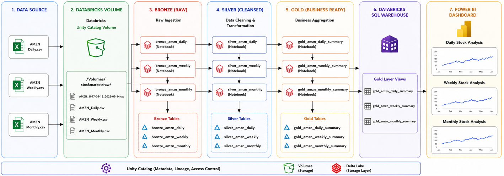
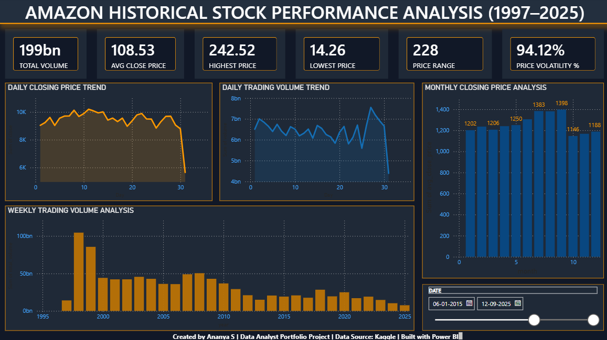

# 📈 AMAZON HISTORICAL STOCK PERFORMANCE ANALYSIS (1997–2025)

## 📌 Project Overview

This project focuses on analyzing Amazon's historical stock market performance from 1997 to 2025 using **Databricks, SQL, and Power BI**.

The project follows the Medallion Architecture (Bronze, Silver, and Gold) to organize and transform historical stock market data into structured datasets. These datasets are used to develop an interactive Power BI dashboard featuring KPI reporting, stock price trends, trading volume analysis, and historical performance insights.

The main objective is to transform raw stock market data into meaningful visual insights through data processing, aggregation, and business intelligence reporting.

---

## 🎯 Business Objective

The objective of this project is to analyze Amazon's historical stock performance and understand its price movements and trading activity over time.

The analysis focuses on:

- Understanding long-term stock price movements.
- Analyzing daily, weekly, and monthly trading patterns.
- Monitoring historical trading volume.
- Evaluating stock price ranges and variations.
- Developing KPIs to summarize historical performance.
- Presenting insights through interactive visualizations.

---

## 📊 Dataset Information

**Data Source:** Kaggle  
**Company:** Amazon (AMZN)  
**Analysis Period:** May 1997 – September 2025

The dataset contains historical stock market information, including:

| Column | Description |
|---|---|
| Date | Trading date |
| Open | Opening stock price |
| High | Highest stock price |
| Low | Lowest stock price |
| Close | Closing stock price |
| Volume | Number of shares traded |

The original dataset was used to create daily, weekly, and monthly aggregated datasets for further analysis.

---

## 🏗️ Project Architecture



The solution follows a Medallion Architecture (Bronze, Silver, Gold) implemented in Databricks.

### Architecture Layers

**1. Bronze Layer – Raw Data**

- Ingested the original Amazon historical stock dataset.
- Maintained the raw data as the initial processing layer.

**2. Silver Layer – Data Transformation**

- Processed and transformed the stock market data.
- Prepared structured data for analytical operations.

**3. Gold Layer – Business-Ready Data**

Created aggregated datasets for different analysis periods:

- `gold_daily_summary`
- `gold_weekly_summary`
- `gold_monthly_summary`

**4. Analytics and Visualization**

- Used the Gold datasets for analytical reporting.
- Developed an interactive Power BI dashboard with KPI cards and visualizations.

---

## 🛠️ Tools & Technologies

| Technology | Purpose |
|---|---|
| Databricks | Data processing and Medallion Architecture |
| SQL | Data querying and aggregation |
| Power BI | Interactive dashboard development |
| DAX | KPI calculations and measures |
| Power Query | Data preparation |
| Data Modeling | Organizing data for analysis |

---

## 📈 Dashboard KPIs

The Power BI dashboard includes the following key performance indicators:

| KPI | Description |
|---|---|
| Total Volume | Total trading volume across the dataset |
| Average Close Price | Average historical closing price |
| Highest Price | Maximum recorded stock price |
| Lowest Price | Minimum recorded stock price |
| Price Range | Difference between the highest and lowest prices |
| Price Volatility % | Overall high-low price range relative to the highest recorded price |

---

## 📉 Dashboard Features

### 1. Daily Closing Price Trend

Visualizes Amazon's daily closing price movements over the analysis period.

### 2. Daily Trading Volume Analysis

Shows daily trading activity and volume fluctuations.

### 3. Weekly Trading Volume Analysis

Provides an aggregated view of trading volume at the weekly level.

### 4. Monthly Closing Price Analysis

Highlights monthly closing-price patterns and long-term trends.

### 5. Interactive Date Filtering

Allows users to explore stock performance across selected time periods.

### 6. Dynamic KPI Reporting

Displays key stock performance indicators through Power BI KPI cards.

---

## 🧮 DAX Measures

### Price Range

Calculates the difference between the highest recorded price and the lowest recorded price.

```dax
Price Range =
MAX(gold_daily_summary[high]) -
MIN(gold_daily_summary[low])
```

### Price Volatility %

Calculates the overall high-low price range relative to the highest recorded price.

```dax
Price Volatility % =
DIVIDE(
    MAX(gold_daily_summary[high]) -
    MIN(gold_daily_summary[low]),
    MAX(gold_daily_summary[high])
) * 100
```

**Note:** This is a range-based percentage indicator, not a statistical measure of historical volatility.

---

## 🖼️ Dashboard Preview

### Amazon Historical Stock Performance Dashboard



The Power BI dashboard presents key performance indicators, historical stock price trends, trading volume analysis, and interactive date filtering.

---

## 🔍 Key Insights

- Analyzed Amazon's long-term stock price movements from 1997 to 2025.
- Examined historical trading volume patterns across different time periods.
- Compared daily, weekly, and monthly stock market trends.
- Used KPI measures to summarize historical stock performance.
- Developed interactive visualizations to explore price and volume movements.

---

## 📂 Repository Structure

```text
amazon-historical-stock-performance-analysis/
│
├── assets/
│   ├── architecture_diagram.png
│   └── dashboard_preview.png
│
├── data/
│   ├── AMZN_1997-05-15_2025-09-14.csv
│   ├── gold_daily_summary.csv
│   ├── gold_monthly_summary.csv
│   └── gold_weekly_summary.csv
│
├── Amazon_Stock_Analysis_Dashboard.pbix
│
└── README.md
```

---

## 💡 Skills Demonstrated

- Data Ingestion and Transformation
- Medallion Architecture
- SQL Querying and Aggregation
- Data Modeling
- DAX Development
- KPI Development
- Power BI Dashboard Development
- Data Visualization
- Trend Analysis
- Business Intelligence Reporting

---

## 🚀 Project Outcomes

- Developed an end-to-end stock market analytics project.
- Organized historical stock data using the Medallion Architecture.
- Created daily, weekly, and monthly aggregated datasets.
- Developed custom DAX measures for KPI reporting.
- Built an interactive Power BI dashboard for historical stock analysis.
- Gained practical experience in data processing, analytical reporting, and data visualization.

---

## 👩‍💻 Author

**Ananya S**

Aspiring Data Analyst | Data Engineer

📧 Email: ananyas.official.in@gmail.com

🔗 [LinkedIn](https://www.linkedin.com/in/ananyas03)

🔗 [GitHub](https://github.com/ananya03ann)

---

⭐ If you find this project interesting, feel free to explore the repository.

